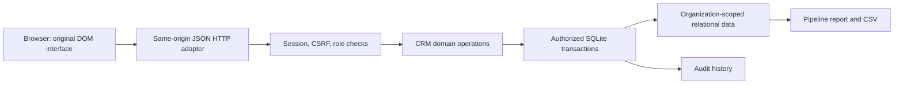

# Architecture and design decisions

Decision date: 2026-10-12. Target for 0.1.0: a complete, inspectable CRM workflow on one trusted host, with no mandatory paid API or runtime package. The long-term system is a modular suite; only its initial CRM and a subset of shared platform capabilities are implemented.

## Module boundaries

| Module | Responsibility |
|---|---|
| `commonstead/database.py` | Schema version, atomic initialization, foreign keys, WAL and transaction lifetimes |
| `commonstead/service.py` | Validation, sessions, roles, invitations, domain workflows, imports/exports/reporting/audit |
| `commonstead/server.py` | Bounded HTTP/JSON routing, headers, Host/Origin checks, cookies/CSRF, static allowlist |
| `commonstead/static/` | Responsive interface, labeled controls, native dialogs/tables, DOM text rendering |
| `tests/` | Business workflow and independent adversarial regression evidence |
| `scripts/` | Fictional fixtures, clean installation, bounded performance and release inspection |

## Data and authorization

An organization owns users, accounts, contacts, leads, opportunities, activities, invitations, and audit events. Users have exactly one organization per account; the same email can register separate accounts in different organizations. A session selects one user and therefore one organization. The organization is derived from the session, never accepted from record mutation bodies.

Accounts relate to contacts and opportunities. Activities can reference an account/opportunity and are assigned to a tenant user. Composite foreign keys pair organization and related ID; application lookups also scope by organization. Opportunity amounts are integer USD cents (0–9,000,000,000,000 per opportunity); the report uses unweighted sums. Dates are plain ISO calendar dates, and overdue uses UTC. Core entities use UUIDs; audit timestamps are UTC. Fixed fields, stages, roles, and currency keep the first workflow explicit.

| Action | Viewer | Member | Admin | Owner |
|---|---|---|---|---|
| Read all organization CRM, members, reports; export contacts | Yes | Yes | Yes | Yes |
| Create/update CRM, import contacts, assign activities | No | Yes | Yes | Yes |
| Delete unreferenced CRM records | No | No | Yes | Yes |
| View audit history | No | No | Yes | Yes |
| Invite member/viewer | No | No | Yes | Yes |
| Invite admin | No | No | No | Yes |
| Change user roles, including promotion to owner | No | No | No | Yes |

The last owner cannot be demoted. Database write transactions recheck current session validity and role after acquiring the write lock, preventing an old authorization snapshot from outliving a concurrent revocation. Invitations are random single-use bearer tokens, hashed at rest and consumed in the user-creation transaction. A replacement invite for an email invalidates outstanding links. Sessions expire after 12 hours; invitations after seven days.

Every domain mutation and its audit event commit together. A failing row rolls back a whole contact import. Existing references prevent a delete; no hidden cascade discards CRM data. Audit contains action/field names and limited administrative details, not passwords, session tokens, invitation tokens, or full record snapshots. Audit is not tamper-resistant against host administrators.

## Why this stack

Python/SQLite/standard DOM keeps installation small, offline-capable, and transparent. It avoids a frontend dependency tree and a mandatory separate database. SQLite permits concurrent readers and serializes writes; this is an intentional single-host limitation. A server-generated same-origin session keeps browser credentials out of localStorage. There is no telemetry or CDN asset request.

The cost is maintaining sensitive identity/HTTP code and a compact domain module. This is appropriate only for the bounded local release claim. The [foundation evaluation](foundations.md) compares Django, Frappe, existing CRMs, identity servers, storage and job frameworks. Before remote deployment, prefer migration to a maintained production framework with PostgreSQL, externally reviewed identity and session lifecycle, and separate jobs. Add architecture complexity only with concrete acceptance tests and migration evidence.

## Shared platform: implemented and deferred

Implemented: organization accounts, four fixed roles, isolation, CRUD relationships, per-entity text search, contact import/export, application audit, first-party API, deterministic report, UI primitives, and local deployment configuration.

Deferred: custom objects/fields/relationships, user-configurable record permissions, file storage/scanning, general report builder, workflow definitions, schedules, background queues, event outbox, webhooks, third-party adapters, OAuth/SSO/MFA, notification delivery, metadata migrations, enterprise administration, offline sync, and high availability. These are architectural requirements, not placeholder modules or completed services.

Expansion order: shared platform hardening → customer service/knowledge → consent-aware marketing → catalog/commerce/revenue → reporting/data/integration → collaboration → industries → application development → AI. The more detailed [roadmap](roadmap.md) assigns every discovered family to an increment, including cross-cutting dependencies and lifecycle watchlists.

## Compatibility policy

Equivalent user outcomes are implemented independently. Salesforce names appear only for source attribution and scope mapping. There is no Salesforce wire protocol, Apex/SOQL, metadata, UI, security-rule, workbook, package, or integration compatibility claim. New adapters need versioned public contracts, explicit authorized access, replayable fixtures, license review, failure/retry behavior, and an actual integration test. AI remains planned; model licenses, hardware and inference costs must be evaluated per selected model.
